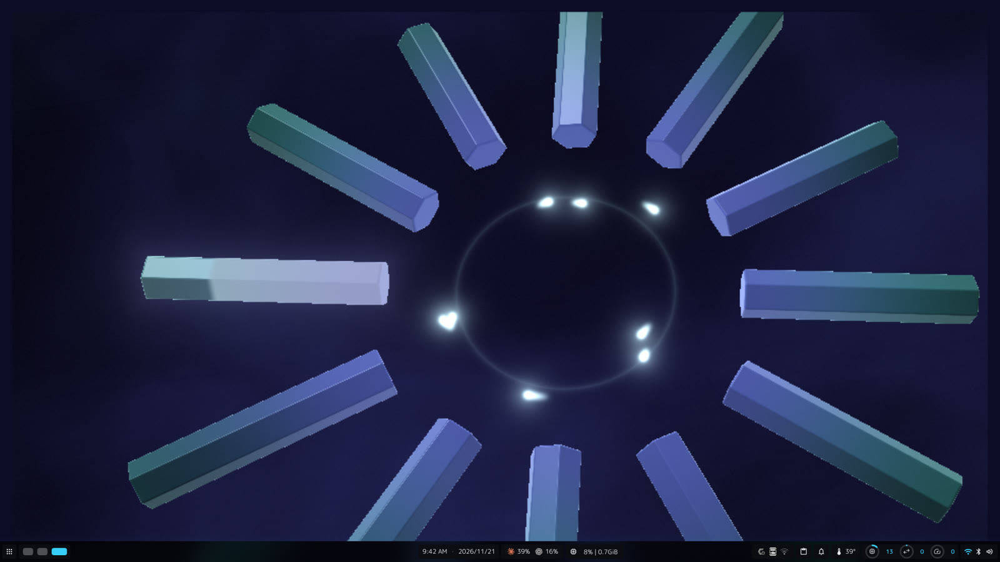
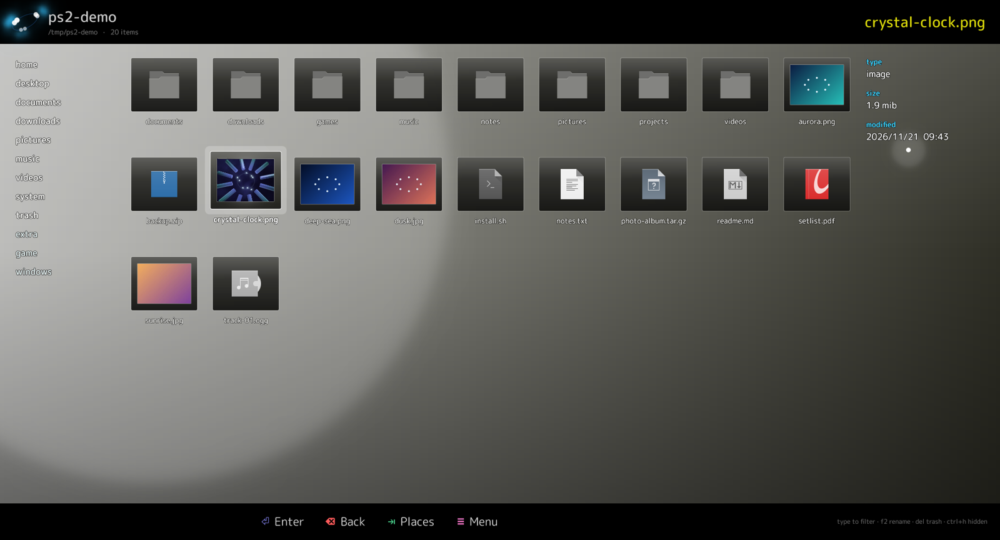
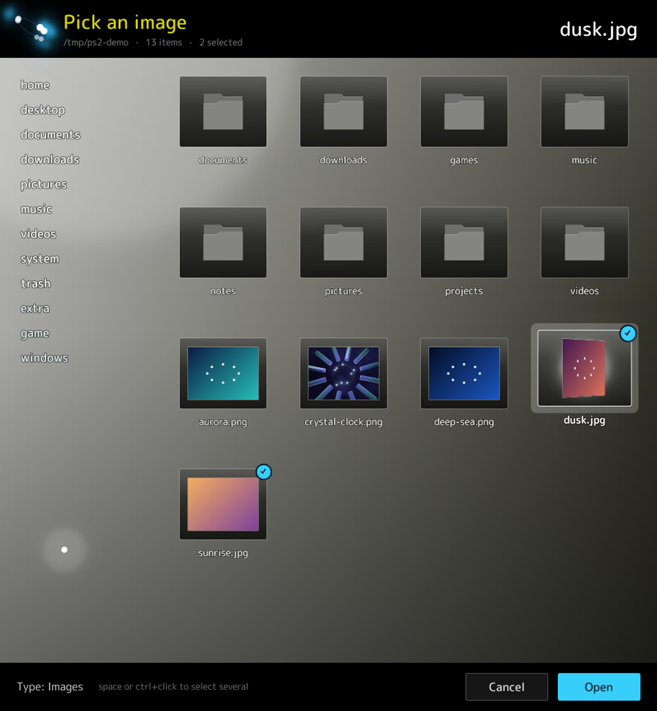
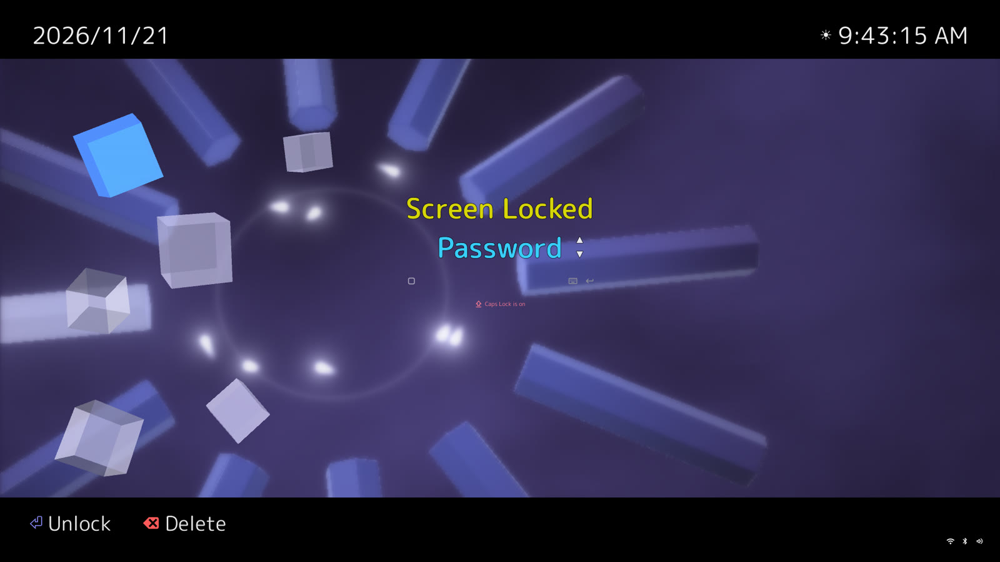
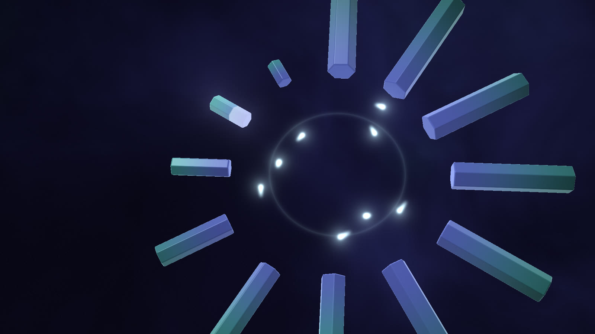
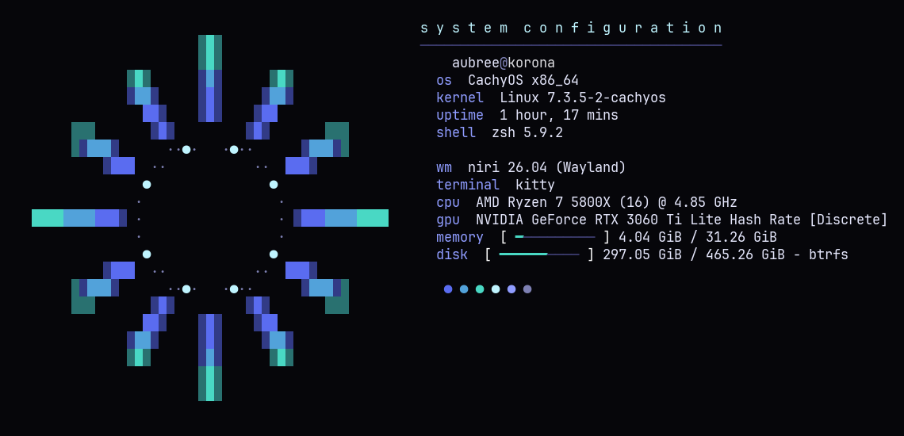

# dms2-niri

a playstation 2 bios inspired look for dankmaterialshell on niri. menu sounds,
an animated crystal clock background, a purple prism lock screen, a boot animation,
a file browser that also works as your file picker, and a theme to tie it together.

unofficial fan project, not affiliated with sony. no sony audio or art is included
in this repo. see the sounds section.



| | |
|---|---|
|  |  |
| file browser | file picker (open, save, folders) |
|  |  |
| lock screen, system configuration style | boot animation |



## what you get

- desktop background: a live crystal clock. twelve prisms are the hours, the current
  one lights up and fills with the minutes, orbs circle the middle.
- lock screen: tumbling glass cubes over the clock, tinted purple and blurred. two
  styles in the plugin settings: classic (time and date in the corner, the default)
  or system configuration (date and time bars, title, button hints).
- boot animation: plays once per login, before the shell has loaded. click or press
  any key to skip.
- sounds: ps2 menu sounds on popouts, the app launcher (moving and launching),
  workspace switches, new windows, lock and unlock, notifications and volume.
- file browser (`ps2-browser`): styled after the bios browser screen. grid of tiles,
  places, thumbnails, rename, trash, new folder, filter, and ps2 sounds. it can be
  your default file manager and the file picker apps open (see below).
- theme: black and sky cyan like the main menu, a rounded font, crisp corners,
  frosted glass popouts, a plain black bar.
- optional: fetch and fastfetch configs with an ascii crystal clock.

## requirements

- dankmaterialshell 2.1 or newer, with quickshell
- niri (the boot animation and backdrop tweaks are niri only)
- python3, ffmpeg, jq, rsync, git, curl, fontconfig
- optional: qt6-shadertools (`qsb`) to rebuild shaders, wl-clipboard for "copy path",
  python numpy and scipy to decode sounds from a bios dump

## install

```
git clone https://github.com/aubree-lat/DMS2-niri
cd DMS2-niri
./install.sh
```

the installer checks dependencies, installs the m plus rounded 1c font if you don't
have it, downloads the sound pack, installs everything into your home directory and
then asks before changing any settings. nothing needs sudo.

options:

```
./install.sh -y            answer yes to everything
./install.sh --no-look     only install files, leave your settings alone
./install.sh --bios FILE   decode sounds from this bios dump
./install.sh --no-bios     skip the bios step
./install.sh --fetch       also write fetch and fastfetch configs
./install.sh --no-default  don't offer to make ps2-browser the default file manager
```

what "apply the look" changes: the dms theme, font, corner radius, animation speed,
blur, bar style, lock screen widgets, wallpaper and system sound theme, plus two lines
in `~/.config/niri/config.kdl` (one to start the boot animation, one to make the
backdrop black). every line it adds is tagged `// ps2Bios`. your keybinds are not touched.
the originals are backed up the first time.

## default file manager and file picker

the installer asks whether ps2-browser should be your default. you can also run
`./scripts/default-browser.sh enable` (or `disable`) any time. enabling it:

- opens folders in ps2-browser
- handles "show in folder" from apps, through `org.freedesktop.FileManager1`
- answers open and save dialogs through xdg-desktop-portal, with open, open several,
  choose folder and save modes, file type filters and a replace prompt

the first two are per-user. the file picker needs one small file in
`/usr/share/xdg-desktop-portal/portals`, so the script prints a single sudo command for
it. after running that, log out and back in. until then dialogs keep using your
previous picker (kde, then gtk).

to keep ps2-browser as your file manager but go back to the kde (dolphin style) file
dialog, run `./scripts/default-browser.sh picker-off` (`picker-on` switches back).

which apps use the picker: chromium based browsers and flatpak apps ask the portal on
their own. gtk apps are pointed at it with `GTK_USE_PORTAL=1` and `GDK_DEBUG=portals` in
`~/.config/environment.d` (after your next login). firefox needs
`widget.use-xdg-desktop-portal.file-picker` set to 1 in `about:config`. qt apps using
the kde platform theme keep their own dialog.

picker keys: enter opens or saves, ctrl + enter chooses, space or ctrl + click marks
several files, f3 switches file type, tab jumps to the name field, esc steps back and
cancels once there is nowhere left to go back to.

## uninstall

```
./uninstall.sh                restore your settings and remove everything
./uninstall.sh --keep-sounds  same, but keep the sounds decoded from your bios
```

## sounds

the sounds are sony's, so they are never stored in this repo. they come from two places:

1. the ps2 system sounds pack by junomede
   (https://github.com/Junomede/PS2-System-Sounds), downloaded at install time.
2. your own ps2 bios dump, if you have one. the installer finds the one pcsx2 is set to
   use, or you can pass `--bios FILE`. this decodes the real cursor tick, the edge bump
   and the boot jingle, and uses them instead of the pack versions.

decoded sounds land in `~/.local/share/ps2-bios-sounds`. to switch back to the pack:
`PS2_PACK_ONLY=1 ./scripts/install-files.sh`.

### how the bios decoding works

the bios image has a file table (romdir). one entry, `SNDIMAGE`, is a second romdir with
the sound banks and sequences. those are compressed with a small lz scheme
(`tools/osdlz.py`). inside are spu2 adpcm sample banks, voice presets, vab style
programs and midi like sequences. `tools/ps2snd.py` plays them back like the spu2 does:
adpcm decoding, the adsr envelope generator, loop flags, the program and sequence
formats, and a reverb in place of the spu2's own.

it was checked against recordings of the real bios running in pcsx2:

- the cursor tick is osd preset 5. it explains 91% of a recorded cursor move.
- the boot jingle is the `SNDBOOTS` sequence. it matches the recording at 0.97
  (envelope) and 0.82 (spectrogram).
- the noise rush about 4.5 seconds into the boot jingle is not in the sound data. the
  bios menu program switches on the spu2 noise generator for it, so that part is
  rebuilt from the recording rather than decoded.

## file browser keys (normal mode)

```
arrows            move
enter             open
backspace         up a folder
esc               back to where you were (alt + left does the same)
alt + right       forward
type              filter
ctrl + h          show hidden files
f2                rename
delete            move to trash (asks first)
ctrl + shift + n  new folder
ctrl + c          copy path
ctrl + t          terminal here
ctrl + e          open in your file manager
ctrl + l          go to a path
tab               places
right click       menu with all of the above
ctrl + q          quit
```

## settings

dms settings > plugins > ps2 bios: sound toggles and volume, the boot animation,
frame rate and resolution of the background, orbs, grain, and theme colors.

replay the boot animation with `dms ipc call ps2bios intro`, or play any sound with
`dms ipc call ps2bios cue navigate`.

## layout

```
plugin/ps2Bios/    dms plugin: sound daemon, clock background, lock screen, boot animation
theme/ps2Bios/     dms color theme
browser/           the file browser (quickshell), its d-bus service and portal file
intro/             standalone boot animation started by niri
fetch/             fetch and fastfetch config generator
scripts/           install, look, revert, sound pack and bios extraction scripts
tools/             bios unpacking and spu2 rendering tools
wallpapers/        a still of the clock for the overview and login screen
docs/screenshots/  the images in this readme
```

shader previews: copy `scripts/preview/shell.qml` into an empty folder and run
`PS2_QSB=$PWD/plugin/ps2Bios/shaders/ps2clock.frag.qsb qs -p <that folder>`.

## license

mit, see `LICENSE`. covers the code and the art made for this project. the ps2 sounds,
bios and names belong to sony.
